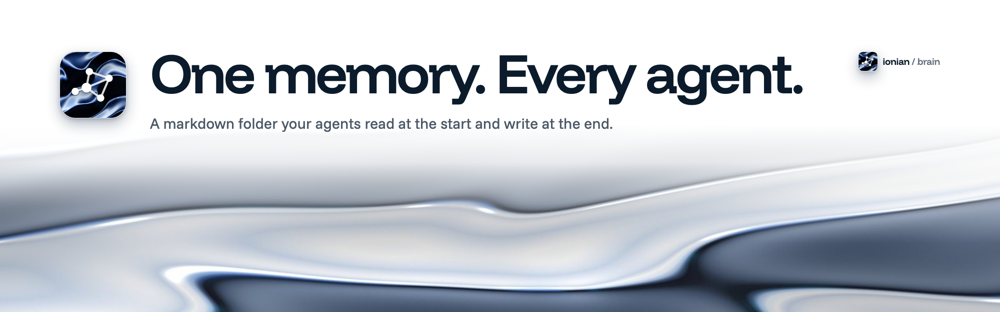

<picture>
  <source media="(prefers-color-scheme: dark)" srcset="docs/images/banner-dark.png">
  
</picture>

# Ionian Brain

One memory for all agents, in plain markdown.

## The problem.

Every agent chat starts at zero. The context lives in your head, in old chats and in copy-paste. You explain the same project again, and the agent still gets it wrong.

## Quickstart.

Add the plugin to your agent. It holds five skills and nothing else: `agenda`, `drop`, `triage`, `sync` and `aware`. It needs no CLI, no Node and no hook, so it works in Claude Code and in the Claude desktop app with access to your brain folder. The skills read and write the markdown files directly.

| Agent | Install | Run |
|---|---|---|
| Claude Code | `/plugin marketplace add ionianlabs/brain`, then `/plugin install brain@ionianlabs` | `/brain:agenda` |
| Copilot CLI | `copilot plugin marketplace add ionianlabs/brain`, then `copilot plugin install brain@ionianlabs` | `/agenda` |
| Copilot in VS Code | Add `ionianlabs/brain` to `chat.plugins.marketplaces`, then install `brain` from **Chat: Plugins** | `/brain:agenda` |

The same marketplace lists Ionian Harness, a separate plugin for spec-first, test-first work in a code repo: `/plugin install ionian-harness@ionianlabs`. Brain does not need it, and it does not need Brain.

You need a brain folder first, one with an `AGENTS.md` at its root. Create it with the optional CLI below, or copy `template/` from this repo. In the Claude desktop app, connect the folder. In Claude Code, the skills look in `~/Ionian/brain`, or in `BRAIN_DIR`. Then say "agenda".

To create a brain, or without the plugin, clone the repo and run the optional CLI from it:

```sh
git clone https://github.com/ionianlabs/brain
node brain/bin/brain.mjs init            # creates ~/Ionian/brain
node brain/bin/brain.mjs init --example  # same, with sample projects
```

Then open your agent in `~/Ionian/brain` and say "agenda", or "Read skills/agenda/SKILL.md and follow it."

At the end of a session, say "sync". To capture a thought from any chat, say "drop this: …", and "triage" places it later.

Details, updates and the routes without the plugin are in [The Brain plugin](https://github.com/ionianlabs/brain/blob/main/docs/plugin.md). Skills use the folder named in the session, else a shared folder with an `AGENTS.md`, else `BRAIN_DIR`, else `$IONIAN_HOME/brain`, else `~/Ionian/brain`.

The plugin has no requirements. The optional CLI needs Node 20 or newer.

### Add your own project.

Copy `templates/project.md` to `projects/<slug>.md` and `templates/log.md` to `logs/<slug>.md`, fill in the frontmatter and add the project's line to `index.md`. Or ask your agent to start a project. `AGENTS.md` has the steps.

Agents keep the index lines in step by hand. If they drift, `brain index` in a terminal repairs them.

For a walk through one full day, read [A day with Brain](https://github.com/ionianlabs/brain/blob/main/docs/a-day-with-brain.md).

Brain also works next to Ionian Harness. See [Works with Ionian Harness](https://github.com/ionianlabs/brain/blob/main/docs/works-with-harness.md). With Ionian Flow, its Aware feature proposes to-dos, decisions and facts from what you say, and the `aware` skill lets you review them. See [Works with Ionian Flow](https://github.com/ionianlabs/brain/blob/main/docs/works-with-flow.md).

## What is in the folder.

```
~/Ionian/brain/
  AGENTS.md        the rulebook every agent reads first
  index.md         generated list of projects and knowledge
  projects/        one short state file per project
  logs/            one append-only history per project
  inbox/           quick captures, triaged at the next session
  knowledge/       durable reference notes
  templates/       note templates
  skills/          example skills: agenda, drop, triage, sync, aware
  .confidential/   notes agents leave alone (gitignored)
```

`AGENTS.md` is the only agent instruction file. Claude Code and GitHub Copilot both read it natively, so no pointer files are needed.

## How it works.

Read at the start, write at the end.

At the start, the agent reads `AGENTS.md`, then `index.md`, then the state file of the project at hand. It also checks the inbox. At the end, it updates the state file, moves done items and decisions to the log, sets `updated` and keeps the index lines in step by hand.

I will be honest. Reading is easy. Writing is the habit that matters, and it is the part people skip. The `sync` skill exists to make it cheap: one word, and the agent does the bookkeeping.

## What a project file looks like.

A state file describes the present. It never holds history. It has four sections, always in this order: Now, Open, People, Links.

```markdown
## Open

- [ ] Send a test order confirmation (owner: Theo, due: 2026-11-04)
- [ ] Migrate the event calendar (owner: Jonas, due: 2026-11-12, blocked: waiting for the old site export)
```

Owner and due date are optional. Done items move to the log, which is a list of dated entries, newest first, with `Decision:` and `Done:` bullets. That split is why the state file stays short enough to read in full every time. See the [sample brain](https://github.com/ionianlabs/brain/blob/main/examples/sample-brain/index.md) for a filled example.

## What the agenda gives you.

Say "agenda" and the agent reports what needs you now, as tables: at most 5 items each, ranked across projects, with everything else folded into counts. It reads, and it never edits.

The default report has these parts:

- A summary line first: `4 need you · 2 coming up · 1 blocked · inbox: 3 captures`.
- A Needs you table: overdue items, then items due today, then p0 items with no date. Each row has the priority, the item, its project, the due date and who to talk to. When more than 5 items are p0, a line says the priorities need re-ranking.
- Coming up: p0 and p1 items due in the next 3 days.
- Blocked items, with what they wait for and who to talk to.
- A Next line with the one action to take, and one line that folds the rest into counts.

Say "agenda everything" for the full report: one heading per org (`personal` last), one table per project, and the inbox at the end.

## What Brain adds on top of OKF.

| Addition | What it does | Why |
|---|---|---|
| **Session protocol** | One `AGENTS.md`: read at start, write at end. | Works with any agent. The plugin is optional. OKF has no write workflow. |
| **State and history split** | A short current file per project (about 300 words plus open items), project notes read on demand, and an append-only log. | Reads stay cheap and nothing is lost. |
| **Boundaries** | An `org` key keeps clients apart. `.confidential/` holds notes agents leave alone. | Safe across several clients. OKF has no access control. |
| **Capture path** | `inbox/`, triaged at the next session. | Aimed at the real bottleneck, which is writing. |
| **Daily payoff** | `agenda`, `drop`, `triage` and `sync` example skills. | You feel the value the same day. |
| **Hygiene** | The skills follow the org boundary and budget rules. The optional `brain lint` checks staleness, broken links, tag near-duplicates, cross-org links and OKF conformance. | The folder stays trustworthy. |

A brain stays a valid OKF v0.2 bundle, so any OKF tool can read it.

## Where it works.

- **Claude desktop app.** The plugin, with the brain folder shared. The skills read and write the files, no terminal needed.
- **Claude Code.** The plugin, or `AGENTS.md` (read natively) and the `agenda`, `drop`, `triage` and `sync` skills in the brain folder. Without the plugin, `init --link-skills` symlinks the skills into `~/.claude/skills/`, so they work in every project. Existing skills with the same name are left alone.
- **GitHub Copilot.** The plugin, in Copilot CLI and in VS Code. Without it, `AGENTS.md` (read natively) and prompt files such as `/agenda` and `/sync`. See [docs/copilot.md](https://github.com/ionianlabs/brain/blob/main/docs/copilot.md) to use them from inside a work repo.
- **Any agent that can read a file.** Point it at `AGENTS.md`.

## CLI.

An optional terminal tool, not part of the plugin: no skill needs it. It creates a brain and keeps the folder in shape. It never talks to a model.

Run it from a clone as `node bin/brain.mjs <command>`. Below, `brain` stands for that.

```sh
brain init [dir]     # copy the template into dir (default ~/Ionian/brain), never overwrite
brain index [dir]    # write the generated block in index.md (default: .)
brain lint [dir]     # check the brain against the spec (default: .)
brain open [dir]     # list open items across projects, ranked (default: .)
```

Options:

- `init`: `--example` also copies the fictional sample notes. `--link-skills` symlinks the skills into `~/.claude/skills`.
- `index`: `--check` writes nothing and exits 1 if the index is out of date.
- `lint`: `--json` prints findings as JSON. `--stale-days N` sets the days before an active project is stale (default 14). `--today DATE` treats DATE (YYYY-MM-DD) as today.
- Anywhere: `-h, --help` and `-v, --version`. `brain <command> --help` prints usage for that command.

Exit codes: 0 ok, 1 errors found, 2 usage error. `lint` never writes files.

The full contract is in [docs/spec.md](https://github.com/ionianlabs/brain/blob/main/docs/spec.md).

## Principles.

- Plain markdown and YAML.
- Any agent. No lock-in.
- Local and private by default. Nothing leaves your machine unless you add a git remote.
- History is append-only.
- Standard markdown links, so it works in Obsidian, VS Code or a browser, and depends on none of them.

## Not in scope.

- No app.
- No hosted sync.
- No database.
- No vector search.
- No accounts.

## Credit.

The format borrows from Google's [Open Knowledge Format v0.2](https://github.com/GoogleCloudPlatform/open-knowledge-format). From it, Brain takes:

- a directory of markdown files
- YAML frontmatter with a required `type`
- generated indexes
- standard links

## Status.

v0.1. I am building it, and I use it every day. Expect rough edges and changes to the format before 1.0.

## License.

MIT. Part of [Ionian Labs](https://ionian.dev).
